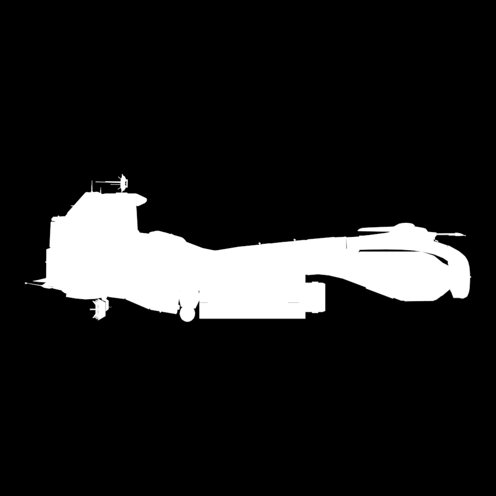

# Heavy Centaur Prototype

An X4: Foundations 9.00 mod that adds the Heavy Centaur Prototype (HCP), a unique Argon experimental heavy frigate ported from X3: Farnham's Legacy. One derelict copy drifts in Black Hole Sun IV with a Teladi Kestrel in its hangar: find it, repair it and claim it. It has a vertical launch system for torpedoes and guided missiles, a built-in hull shield generator, a bridge and an interior hangar. The ship is not sold anywhere.

## Layout

- `mod/heavy_centaur_prototype/`: the release extension.
- `mod/heavy_centaur_prototype_dev/`: bench helpers for testing, never shipped.
- `mod/heavy_centaur_prototype_vro/`: patch for the VRO mod, untested.
- `tools/`: scripts to extract and convert X3 assets.

## Build a release

1. Raise `version` and `date` in `mod/heavy_centaur_prototype/content.xml`.
2. Pack the extension with `x4-ext-zip zip mod/heavy_centaur_prototype <output>.zip`. It checks `content.xml`, the XML and the text ids, and puts `heavy_centaur_prototype/` at the root of the zip.

The files stay loose (no `.cat` catalog).

## Not included

The Egosoft game assets used as reference (`source/`) are not part of this repository, nor any `.blend` file.

## Credits

The original X3 design is by Egosoft. This port is by Darkona.

## License

MIT, see [LICENSE](LICENSE). The original X3 Heavy Centaur design and all X4 game assets belong to Egosoft and are not covered by this license.
